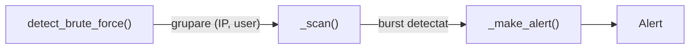

# Detecția Brute-Force — `rules.py` & `test_rules.py`

Acest document explică pas cu pas cum funcționează modulul de detecție brute-force
și cum acoperă testele fiecare scenariu.

---

## 1. Scopul modulului

`rules.py` detectează atacuri de tip **brute-force** asupra autentificării.
Regula e simplă:

> Dacă un IP trimite **≥ threshold** încercări eșuate pentru același username
> într-o fereastră de **window_seconds**, generează un `Alert`.

Valorile implicite: **5 încercări** în **60 de secunde**.

Tehnica MITRE ATT&CK mapată: `T1110.001` (Password Guessing).

---

## 2. Arhitectura — cele 3 funcții



### 2.1 `detect_brute_force(events, threshold=5, window_seconds=60)`

**Punct de intrare.** Primește o listă de `AuthEvent`-uri (pot fi nesortate, pot conține și succese).

Pași:
1. **Filtrare** — păstrează doar evenimentele cu `outcome == "failure"`.
2. **Grupare** — le organizează într-un `defaultdict(list)` cu cheia `(source_ip, username)`.
   Astfel, un IP care atacă doi useri diferiți produce două grupuri separate.
3. **Sortare** — fiecare grup e sortat cronologic (`timestamp`).
4. **Scanare** — delegă fiecare grup la `_scan()`.
5. **Returnare** — colectează toate alert-urile, le sortează după `first_seen`.

### 2.2 `_scan(group, threshold, window_seconds)`

**Inima algoritmului.** Folosește tehnica **sliding window cu doi pointeri** (`start` și `end`).

```
group (sortat cronologic):
  index:  0    1    2    3    4    5    6    7    8
          ▲                        ▲
        start                     end
          └──── fereastra ────────┘
```

#### Cum funcționează, linie cu linie:

```python
def _scan(group, threshold, window_seconds):
    alerts = []
    start = 0            # pointer stânga — începutul ferestrei
    burst_start = None   # marchează începutul unui burst activ (sau None)
```

**Loop principal** — `end` avansează eveniment cu eveniment:

```python
    for end, event in enumerate(group):
```

**Evicția** — scoate din fereastră tot ce e prea vechi:

```python
        while (event.timestamp - group[start].timestamp).total_seconds() > window_seconds:
            start += 1
```

> [!IMPORTANT]
> Condiția e `>` (strict mai mare), nu `>=`.
> Asta înseamnă că o diferență de **exact** 60 de secunde e **inclusă** în fereastră.
> Testul `test_window_boundary` confirmă: offset 60 → alertă, offset 61 → nimic.

**Verificare threshold:**

```python
        count = end - start + 1
        if count >= threshold:
            if burst_start is None:
                burst_start = start   # marcăm începutul burst-ului
        elif burst_start is not None:
            # burst-ul tocmai s-a terminat
            alerts.append(_make_alert(group[burst_start:end]))
            burst_start = None
```

Logica stărilor:

| Stare anterioară | count ≥ threshold? | Acțiune |
|---|---|---|
| Nu sunt în burst | Da | Intru în burst: `burst_start = start` |
| Nu sunt în burst | Nu | Nimic |
| Sunt în burst | Da | Burst-ul continuă, nu fac nimic |
| Sunt în burst | Nu | Burst-ul s-a terminat → emit alert, resetez |

**Flush la final** — dacă burst-ul merge până la capătul listei:

```python
    if burst_start is not None:
        alerts.append(_make_alert(group[burst_start:]))
```

> [!NOTE]
> **Evidence-ul include TOATE evenimentele din burst**, nu doar cele din fereastra curentă.
> De exemplu, un burst lung de 40 de eșecuri (câte unul la 3 secunde pe parcursul a 120s)
> produce un singur alert cu toate cele 40 de evenimente, chiar dacă fereastra e de 60s.
> Fereastra decide doar **dacă** suntem într-un burst, nu **ce** includem.

### 2.3 `_make_alert(evidence)`

Constructor simplu. Primește slice-ul de evenimente și construiește un `Alert`:

| Câmp | Valoare |
|---|---|
| `rule_id` | `"brute_force"` |
| `severity` | `"high"` |
| `mitre_technique` | `"T1110.001"` |
| `source_ip` | din primul eveniment |
| `username` | din primul eveniment |
| `first_seen` | timestamp-ul primului eveniment |
| `last_seen` | timestamp-ul ultimului eveniment |
| `evidence` | tuple cu toate evenimentele |

---

## 3. Exemplu vizual — cum se mișcă fereastra

Să zicem `threshold=3`, `window_seconds=5`, cu eșecuri la secundele `[0, 1, 2, 8, 9, 10]`:

```
Pas 1: end=0  fereastra=[0]           count=1  sub threshold
Pas 2: end=1  fereastra=[0,1]         count=2  sub threshold
Pas 3: end=2  fereastra=[0,1,2]       count=3  ≥ threshold → burst_start=0
Pas 4: end=3  event=8s
       while: 8-0=8 > 5 → start=1
              8-1=7 > 5 → start=2
              8-2=6 > 5 → start=3
       fereastra=[8]                  count=1  < threshold
       burst_start era 0 → emit alert(group[0:3]) → burst_start=None
Pas 5: end=4  fereastra=[8,9]         count=2  sub threshold
Pas 6: end=5  fereastra=[8,9,10]      count=3  ≥ threshold → burst_start=3
       → final de loop, burst_start is not None → emit alert(group[3:])

Rezultat: 2 alerte
```

---

## 4. Testele — ce acoperă și de ce

### Helpers

| Funcție | Rol |
|---|---|
| `make_event(**overrides)` | Creează un `AuthEvent` cu valori default (IP, user, outcome=failure). Orice câmp poate fi suprascris. |
| `failures(offsets, ip, user)` | Generează o listă de eșecuri la secundele specificate, pornind de la `START`. |

### Teste individuale

| Test | Ce verifică | Legătura cu codul |
|---|---|---|
| `test_five_failures_in_ten_seconds_raise_one_alert` | **Happy path** — 5 eșecuri rapide produc exact 1 alert cu câmpurile corecte | Verifică tot flow-ul: filtrare, grupare, scan, make_alert |
| `test_below_threshold_raises_nothing` | 4 eșecuri (sub threshold=5) → nimic | `count >= threshold` nu se atinge niciodată |
| `test_slow_failures_raise_nothing` | 5 eșecuri dar la 150s distanță → nimic | `while`-ul din `_scan` scoate mereu start, fereastra nu acumulează 5 |
| `test_failures_on_different_accounts_do_not_add_up` | 5 eșecuri de la același IP dar pe useri diferiți → nimic | Gruparea pe `(IP, username)` le separă |
| `test_successes_are_ignored` | 5 succese rapide → nimic | Filtrarea `outcome == "failure"` le exclude |
| `test_unsorted_input_still_detects` | Input dat în dezordine → detectează | `group.sort()` din `detect_brute_force` |
| `test_one_long_burst_raises_a_single_alert` | 40 eșecuri la 3s interval (120s total) → **1 singur** alert cu 40 evidence | `burst_start` se setează o singură dată; flush la final |
| `test_two_separate_bursts_raise_two_alerts` | 2 grupuri de 5 la 1h distanță → 2 alerte | Burst-ul 1 se termină când fereastra se golește, burst-ul 2 începe |
| `test_failures_from_different_ips_do_not_add_up` | 3 eșecuri de pe IP-A + 3 de pe IP-B → nimic | Gruparea pe `(IP, username)` |
| `test_only_the_ip_over_threshold_raises_an_allert` | IP-A are 5, IP-B are 2 → 1 alert doar pentru IP-A | Grupurile se evaluează independent |
| `test_threshold_boundary` | Parametrizat: count=2→0, count=3→1, count=4→1 (cu threshold=3) | Testează exact granița `count >= threshold` |
| `test_window_boundary` | Parametrizat: offset=60→1 alertă, offset=61→0 | Testează granița `> window_seconds` (strict) |

### Harta de acoperire

```mermaid
flowchart TD
    subgraph detect_brute_force
        F["Filtrare outcome==failure"]
        G["Grupare (IP, user)"]
        S["Sortare cronologică"]
    end

    subgraph _scan
        W["While: evicție din fereastră"]
        T["If count >= threshold"]
        B["Burst tracking"]
        FL["Flush final"]
    end

    F --- test_successes_are_ignored
    G --- test_failures_on_different_accounts_do_not_add_up
    G --- test_failures_from_different_ips_do_not_add_up
    G --- test_only_the_ip_over_threshold_raises_an_allert
    S --- test_unsorted_input_still_detects
    W --- test_slow_failures_raise_nothing
    W --- test_window_boundary
    T --- test_below_threshold_raises_nothing
    T --- test_threshold_boundary
    B --- test_one_long_burst_raises_a_single_alert
    B --- test_two_separate_bursts_raise_two_alerts
    FL --- test_one_long_burst_raises_a_single_alert
```



---

## 5. Bug cunoscut în teste

> [!WARNING]
> `test_threshold_boundary` (linia 74) are un mismatch între parametru și argument:
>
> ```python
> @pytest.mark.parametrize("count, expected_alert", ...)  # ← "expected_alert" (singular)
> def test_threshold_boundary(count, expected_alerts):     # ← "expected_alerts" (plural)
> ```
>
> Pytest injectează după **nume**, deci `expected_alerts` nu va primi valoarea
> și testul va crăpa cu `NameError` sau `TypeError`.
> Fix: schimbă `expected_alert` → `expected_alerts` în decorator (sau invers în semnătura funcției).

